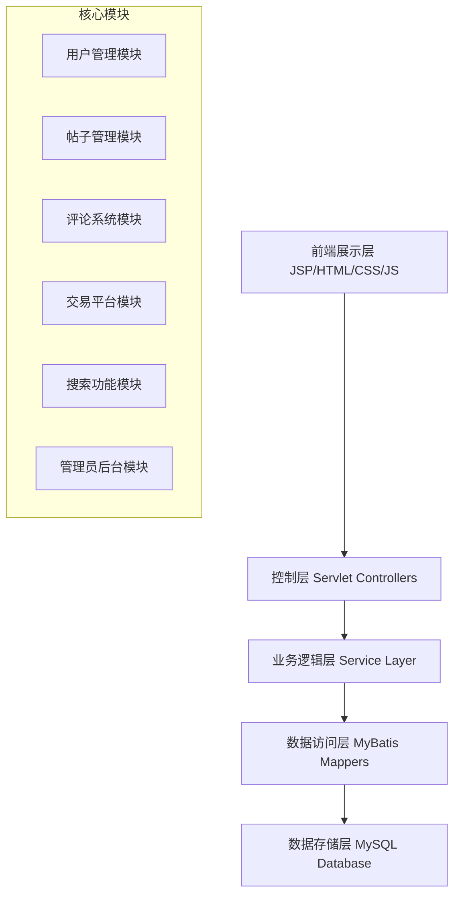

# 🏫 校园贴吧系统

<div align="center">


**一个功能完整的校园社区交流平台**

[功能特性](#-功能特性) • [快速开始](#-快速开始) • [部署指南](#-部署指南) • [API文档](#-api文档) • [贡献指南](#-贡献指南)

</div>

## 📋 项目简介

校园贴吧系统是一个专为大学生设计的现代化在线交流平台，集成了帖子发布、评论互动、用户管理、商品交易等核心功能。系统采用经典的 MVC 架构，提供响应式设计和现代化的用户界面，为校园社区创造便捷的信息交流和资源共享环境。

### 🎯 核心价值
- **📝 内容创作**: 支持富文本帖子发布，包含多媒体文件上传
- **💬 社区互动**: 完整的评论系统，支持点赞和关注功能
- **🛒 交易平台**: 集成的二手商品交易模块
- **👥 用户管理**: 完善的用户权限和管理员后台系统
- **🔍 智能搜索**: 支持全文搜索和分类浏览

## 🛠 技术栈

### 后端技术
| 技术 | 版本 | 说明 |
|------|------|------|
| **Java** | 8+ | 核心编程语言 |
| **Servlet** | 4.0 | Web框架 |
| **MyBatis** | 3.5.6 | ORM框架 |
| **MySQL** | 8.0+ | 关系型数据库 |
| **Log4j2** | 2.20.0 | 日志框架 |
| **Maven** | 3.6+ | 项目构建工具 |

### 前端技术
| 技术 | 版本 | 说明 |
|------|------|------|
| **JSP** | 2.3 | 服务端渲染 |
| **HTML5** | - | 页面结构 |
| **CSS3** | - | 样式设计 |
| **JavaScript** | ES6+ | 交互逻辑 |
| **jQuery** | 3.5.1 | DOM操作库 |

### 部署环境
- **Apache Tomcat** 9.0+
- **Linux/macOS/Windows** 跨平台支持

## 🏗 系统架构



### 📁 项目结构

```
校园贴吧系统/
├── 📂 src/main/
│   ├── 📂 java/com/bbs/
│   │   ├── 📂 controller/          # 控制器层
│   │   │   ├── 📂 admin/          # 管理员控制器
│   │   │   ├── 📂 comment/        # 评论控制器
│   │   │   ├── 📂 post/           # 帖子控制器
│   │   │   ├── 📂 trade/          # 交易控制器
│   │   │   └── 📂 user/           # 用户控制器
│   │   ├── 📂 entity/             # 实体类 (POJO)
│   │   ├── 📂 service/            # 业务逻辑层
│   │   │   └── 📂 impl/           # 服务实现类
│   │   ├── 📂 mapper/             # 数据访问层
│   │   ├── 📂 util/               # 工具类
│   │   └── 📂 exception/          # 异常处理
│   ├── 📂 resources/              # 配置文件
│   │   ├── 📄 mybatis-config.xml  # MyBatis配置
│   │   ├── 📄 log4j2.xml          # 日志配置
│   │   ├── 📄 db.properties.sample # 数据库配置模板
│   │   └── 📄 schema.sql          # 数据库初始化脚本
│   └── 📂 webapp/                 # Web资源
│       ├── 📂 css/                # 样式文件
│       ├── 📂 js/                 # JavaScript文件
│       ├── 📂 images/             # 图片资源
│       └── 📄 *.jsp               # JSP页面
├── 📄 pom.xml                     # Maven配置
├── 📄 deploy.sh                   # 部署脚本
├── 📄 start.sh                    # 启动脚本
├── 📄 stop.sh                     # 停止脚本
└── 📄 README.md                   # 项目文档
```

## ✨ 功能特性

### 👤 用户系统
- [x] **用户注册/登录** - 支持用户名密码认证
- [x] **个人资料管理** - 查看和修改个人信息
- [x] **会话管理** - 安全的用户会话控制
- [x] **密码安全** - 密码掩码保护

### 📝 帖子系统
- [x] **帖子发布** - 支持富文本内容和多媒体文件
- [x] **帖子分类** - 多种帖子类型（学习交流、表白墙、校园生活等）
- [x] **帖子编辑** - 用户可编辑自己的帖子
- [x] **帖子删除** - 支持用户和管理员删除
- [x] **点赞功能** - 帖子点赞与取消点赞
- [x] **关注功能** - 关注感兴趣的帖子类型

### 💬 评论系统
- [x] **评论发布** - 对帖子进行评论
- [x] **评论点赞** - 评论点赞与取消点赞
- [x] **评论管理** - 管理员可管理评论内容

### 🛒 交易平台
- [x] **商品发布** - 发布二手商品信息
- [x] **图片上传** - 支持商品图片展示
- [x] **商品搜索** - 按标题和描述搜索
- [x] **价格筛选** - 按价格区间筛选商品
- [x] **个人交易** - 查看个人发布的商品

### 🔍 搜索功能
- [x] **全文搜索** - 按标题和内容搜索帖子
- [x] **分类浏览** - 按帖子类型浏览
- [x] **分页展示** - 支持分页显示结果
- [x] **排序功能** - 按时间、相关度排序

### 👨‍💼 管理员系统
- [x] **管理员登录** - 独立的管理员认证系统
- [x] **用户管理** - 查看、删除用户，重置密码
- [x] **帖子管理** - 审核和删除不当帖子
- [x] **评论管理** - 管理用户评论内容
- [x] **交易管理** - 管理商品交易信息
- [x] **分类管理** - 管理帖子分类

### 🎨 用户界面
- [x] **现代化设计** - 采用现代化的 UI 设计风格
- [x] **响应式布局** - 适配不同屏幕尺寸
- [x] **交互动画** - 平滑的过渡动画效果
- [x] **统一风格** - 一致的设计语言和组件

## 🚀 快速开始

### 📋 环境要求

确保你的开发环境满足以下要求：

| 软件 | 版本要求 | 说明 |
|------|----------|------|
| **JDK** | 8+ | Java开发环境 |
| **Maven** | 3.6+ | 项目构建工具 |
| **MySQL** | 8.0+ | 数据库服务 |
| **Tomcat** | 9.0+ | Web应用服务器 |

### 🔧 安装步骤

#### 1. 克隆项目
```bash
git clone <your-repository-url>
cd 校园贴吧系统
```

#### 2. 数据库配置
```bash
# 创建MySQL数据库
mysql -u root -p
CREATE DATABASE forumsys CHARACTER SET utf8mb4 COLLATE utf8mb4_unicode_ci;

# 导入数据库结构
mysql -u root -p forumsys < src/main/resources/schema.sql

# 创建数据库配置文件
cp src/main/resources/db.properties.sample src/main/resources/db.properties
```

编辑 `src/main/resources/db.properties` 文件：
```properties
# 数据库连接配置
jdbc.driver=com.mysql.cj.jdbc.Driver
jdbc.url=jdbc:mysql://localhost:3306/forumsys?serverTimezone=UTC&useSSL=false&allowPublicKeyRetrieval=true
jdbc.username=your_username
jdbc.password=your_password
```

#### 3. 编译和部署
```bash
# 使用提供的部署脚本（推荐）
./deploy.sh

# 或手动编译部署
mvn clean package
cp target/untitled2-1.0-SNAPSHOT.war /usr/local/tomcat9/webapps/ROOT.war
```

#### 4. 启动服务
```bash
# 启动Tomcat服务器
./start.sh

# 或手动启动
/usr/local/tomcat9/bin/catalina.sh start
```

### 🌐 访问应用

部署成功后，你可以通过以下地址访问应用：

| 页面 | 地址 | 说明 |
|------|------|------|
| **用户登录** | http://localhost:8080/index.html | 主要入口页面 |
| **用户注册** | http://localhost:8080/signup.html | 新用户注册 |
| **系统首页** | http://localhost:8080/home.jsp | 登录后的主页 |
| **管理员登录** | http://localhost:8080/adminLogin.jsp | 管理员后台入口 |
| **管理员后台** | http://localhost:8080/admin_index.html | 管理员控制面板 |

### 🎯 测试账户

为了快速体验系统功能，你可以：

1. **注册新用户** - 通过注册页面创建账户
2. **管理员账户** - 需要在数据库中手动创建或通过现有管理员创建

## 📊 核心功能模块

### 🏠 首页功能
- **帖子分类展示** - 按类型组织显示帖子
- **关注功能** - 关注感兴趣的帖子类型
- **快速导航** - 便捷的功能入口

### 📝 发帖功能
- **富文本编辑** - 支持格式化文本内容
- **文件上传** - 支持图片、视频、文档等多种格式
- **分类选择** - 选择合适的帖子分类
- **自定义分类** - 创建新的帖子分类

### 🔍 搜索功能
- **关键词搜索** - 按标题和内容搜索
- **高级筛选** - 按分类、时间、作者筛选
- **搜索结果高亮** - 关键词高亮显示

### 🛒 交易平台
- **商品发布** - 详细的商品信息编辑
- **图片管理** - 多张商品图片上传和预览
- **价格管理** - 灵活的价格设置和展示
- **交易状态** - 商品状态管理

## 🔧 配置说明

### 📂 重要配置文件

#### `src/main/resources/mybatis-config.xml`
MyBatis 核心配置文件，包含：
- 类型别名配置
- Mapper 文件路径配置
- 数据源配置引用

#### `src/main/resources/log4j2.xml`
日志配置文件，支持：
- 控制台日志输出
- 文件日志记录
- 不同级别的日志控制

#### `src/main/resources/db.properties`
数据库连接配置（从 `.sample` 文件复制创建）

### 🔒 安全配置

#### 密码安全
- 用户密码存储使用适当的加密方式
- 管理员权限严格控制
- 会话管理安全机制

#### SQL 注入防护
- 使用 MyBatis 预编译语句
- 参数化查询防止 SQL 注入
- 输入验证和过滤

#### 文件上传安全
- 文件类型限制
- 文件大小限制
- 上传路径安全控制

## 🔧 开发指南

### 📝 代码规范

#### Java 代码规范
- 遵循标准的 Java 命名约定
- 使用有意义的变量和方法名
- 适当的注释和文档
- 异常处理规范

#### 前端代码规范
- 语义化的 HTML 结构
- 模块化的 CSS 组织
- 现代化的 JavaScript 编写

### 🔄 数据库设计

#### 主要数据表

| 表名 | 说明 | 主要字段 |
|------|------|----------|
| `user` | 用户信息 | id, username, password, sex, rtime |
| `post` | 帖子信息 | id, title, content, author, postType, date, mediaFiles |
| `comment` | 评论信息 | id, content, author, post_id, date |
| `post_type` | 帖子分类 | id, typeName, description, creator, createTime |
| `trade` | 交易信息 | id, title, price, description, author, images, date |
| `admin` | 管理员信息 | id, adminName, adminPassword |

#### 关系设计
- 用户与帖子：一对多关系
- 帖子与评论：一对多关系
- 用户与评论：一对多关系
- 分类与帖子：一对多关系

### 🛠 扩展开发

#### 添加新功能
1. **创建实体类** - 在 `entity` 包中定义数据模型
2. **创建 Mapper** - 在 `mapper` 包中定义数据访问接口
3. **实现 Service** - 在 `service.impl` 包中实现业务逻辑
4. **创建 Controller** - 在相应的 `controller` 子包中处理请求
5. **设计 JSP 页面** - 创建用户界面

#### 自定义样式
- 修改 `webapp/css/` 目录下的样式文件
- 遵循现有的设计规范和颜色方案
- 确保响应式设计的兼容性

## 🚨 故障排除

### 常见问题及解决方案

#### 1. 数据库连接失败
```
错误信息: SQLException: Access denied for user
```
**解决方案:**
- 检查 `db.properties` 文件中的用户名密码
- 确认 MySQL 服务正在运行
- 验证数据库用户权限

#### 2. JSP 编译错误
```
错误信息: Unable to compile class for JSP
```
**解决方案:**
- 检查 JSP 页面中的 Java 代码语法
- 确认 import 语句正确
- 验证使用的类和方法存在

#### 3. 404 页面未找到
```
错误信息: HTTP Status 404 – Not Found
```
**解决方案:**
- 检查 URL 路径是否正确
- 确认 WAR 包正确部署到 Tomcat
- 验证 web.xml 配置

#### 4. 文件上传失败
```
错误信息: File upload failed
```
**解决方案:**
- 检查上传目录权限
- 确认文件大小限制
- 验证文件类型允许列表

### 📋 日志分析

#### 查看应用日志
```bash
# Tomcat 日志
tail -f /usr/local/tomcat9/logs/catalina.out

# 应用日志
tail -f logs/application.log
```

#### 常见日志错误

1. **ClassNotFoundException** - 检查类路径和依赖
2. **SQLException** - 检查数据库连接和 SQL 语句
3. **FileNotFoundException** - 检查文件路径和权限

## 🔄 更新日志

### v2.0.0 (Current)
- ✨ 重构整体架构，优化代码结构
- 🎨 现代化 UI 设计，提升用户体验
- 🔧 修复所有已知的编译和运行时错误
- 📱 增强响应式设计
- 🛡️ 改进安全性配置
- 📊 完善管理员后台功能

### v1.0.0
- 🎉 初始版本发布
- 📝 基础帖子发布功能
- 💬 评论系统实现
- 👤 用户管理系统
- 🛒 交易平台基础功能

## 🤝 贡献指南

### 贡献流程

1. **Fork 项目** - 创建项目副本
2. **创建分支** - 为新功能创建专门分支
   ```bash
   git checkout -b feature/new-feature
   ```
3. **提交更改** - 遵循提交规范
   ```bash
   git commit -m "feat: add new feature"
   ```
4. **推送分支** - 推送到远程仓库
   ```bash
   git push origin feature/new-feature
   ```
5. **创建 Pull Request** - 描述更改内容

### 代码贡献规范

#### 提交信息格式
```
<type>(<scope>): <subject>

<body>

<footer>
```

**类型说明:**
- `feat`: 新功能
- `fix`: 修复 bug
- `docs`: 文档更新
- `style`: 代码格式调整
- `refactor`: 代码重构
- `test`: 测试相关
- `chore`: 构建过程或辅助工具变动

#### 代码审查要点
- [ ] 代码符合项目规范
- [ ] 包含适当的测试
- [ ] 文档已更新
- [ ] 无明显性能问题
- [ ] 安全性考虑充分

## 📄 许可证

本项目采用 MIT 许可证。详情请参阅 [LICENSE](LICENSE) 文件。

```
MIT License

Copyright (c) 2025 校园贴吧系统

Permission is hereby granted, free of charge, to any person obtaining a copy
of this software and associated documentation files (the "Software"), to deal
in the Software without restriction, including without limitation the rights
to use, copy, modify, merge, publish, distribute, sublicense, and/or sell
copies of the Software, and to permit persons to whom the Software is
furnished to do so, subject to the following conditions:

The above copyright notice and this permission notice shall be included in all
copies or substantial portions of the Software.
```

## 🙏 致谢

感谢以下项目和技术为本项目提供支持：

- **[Apache Tomcat](https://tomcat.apache.org/)** - Web 应用服务器
- **[MyBatis](https://mybatis.org/)** - 持久层框架
- **[MySQL](https://www.mysql.com/)** - 关系型数据库
- **[jQuery](https://jquery.com/)** - JavaScript 库
- **[Maven](https://maven.apache.org/)** - 项目构建工具

## 📞 联系我们

如果您在使用过程中遇到问题或有改进建议，欢迎通过以下方式联系：

- 📧 **邮箱**: [your-email@example.com]
- 🐛 **问题反馈**: [GitHub Issues](https://github.com/your-username/campus-forum/issues)
- 💡 **功能建议**: [GitHub Discussions](https://github.com/your-username/campus-forum/discussions)

---

<div align="center">

**🎓 让校园交流更简单，让知识分享更便捷**

[](https://github.com/your-username/campus-forum/stargazers)
[](https://github.com/your-username/campus-forum/network/members)

[⬆ 回到顶部](#-校园贴吧系统)

</div>